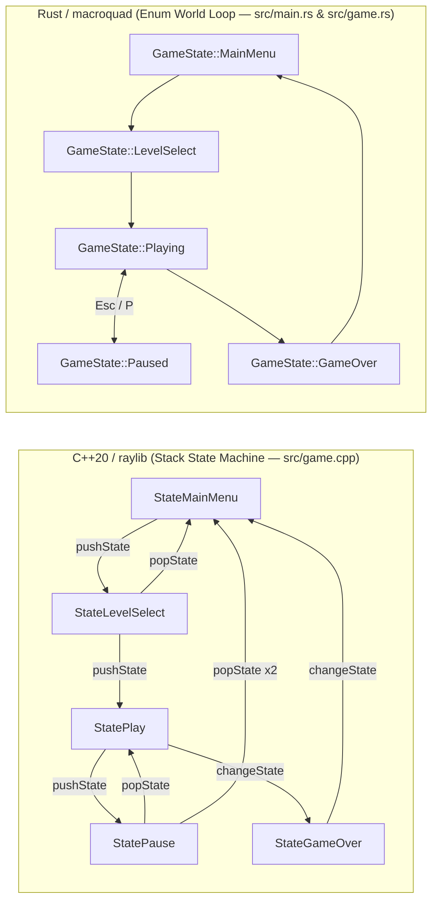

<p align="center"><a href="https://ko-fi.com/todd0042"></a></p>

---

# 🚀 shmuppi

[](CMakeLists.txt)
[](Cargo.toml)
[](CMakeLists.txt)
[](build/shmuppi)
[](https://ko-fi.com/todd0042)

> **A 2D horizontal side-scrolling shoot-'em-up core implemented side by side in C++20 (`raylib`) and Rust (`macroquad`), featuring stack- and enum-driven game states, wave spawning, projectile combat, and invulnerability-frame respawn mechanics.**

---

## 📖 Table of Contents

* **Part 1 — User Overview & Quick Start**
  * [🎯 What Is shmuppi?](#-what-is-shmuppi)
  * [✨ Key Features at a Glance](#-key-features-at-a-glance)
  * [🎮 How the Game Loop Works](#-how-the-game-loop-works)
  * [🚀 Quick Start & Build Instructions](#-quick-start--build-instructions)
* **Part 2 — Technical Architecture & Reference**
  * [1. Dual-Engine Architecture & State Machines (`src/game.cpp`, `src/main.rs`)](#1-dual-engine-architecture--state-machines)
  * [2. Entities, Combat & Collision Mechanics (`src/entities/`, `src/components.rs`)](#2-entities-combat--collision-mechanics)
  * [3. Controls, CLI Flags, Build Options & Data Flow (`src/main.cpp`, `CMakeLists.txt`, `Cargo.toml`)](#3-controls-cli-flags-build-options--data-flow)
  * [4. Repository Structure & File Reference](#4-repository-structure--file-reference)
  * [5. Build Verification & Known Implementation Notes](#5-build-verification--known-implementation-notes)
  * [6. License & Support](#6-license--support)

---

# Part 1 — User Overview & Quick Start

## 🎯 What Is shmuppi?

**shmuppi** is a lightweight, dual-implementation 2D horizontal shoot-'em-up (*shmup*) prototype built from the ground up with zero heavy game-engine overhead. Rather than locking into a single language ecosystem, the repository houses **two playable implementations** sharing the same core arcade structure and PNG sprite assets:

1. **C++20 / raylib (`shmuppi`)**: A modular object-oriented architecture built around a stack-based `GameState` machine ([src/game.cpp](src/game.cpp)), `Player` / `Enemy` / `Bullet` / `EnemyBullet` entity classes, `1280×720` 60 FPS windowing, and CMake + Ninja compilation ([CMakeLists.txt](CMakeLists.txt)).
2. **Rust 2021 / macroquad (`shmuppi-rs`)**: A data-oriented async frame-loop port using `macroquad` `0.4.14` ([Cargo.toml](Cargo.toml)), a flat `World` state container ([src/game.rs](src/game.rs)), and level-scaled enemy spawn/fire rates.

---

## ✨ Key Features at a Glance

* **Dual Language Implementations**: Compare or extend a classic C++20 `raylib` state-stack engine alongside a Rust `macroquad` `World` loop in the same repository.
* **Complete Arcade State Flow**: Both versions implement the full loop across **Main Menu**, **Level / Lives Select**, **Active Gameplay**, **Pause Overlay**, and **Game Over** screens.
* **Configurable Difficulty & Lives**: Choose your starting lives and level before launching into combat—including level-scaled spawn intervals and enemy fire probabilities in the Rust build.
* **Player Survival & Respawn Mechanics**: Features an on-screen HUD (`Level`, `Lives`, and visual `HP` bar), collision detection, damage invulnerability frames (*i-frames*) with sprite blinking, and automatic respawn until lives reach zero.
* **Shared Sprite Asset Pipeline**: Uses RGBA PNG ship sprites under [assets/player/](assets/player/) and [assets/enemies/](assets/enemies/), with shared-texture loading in C++ to avoid dangling GPU handles and automatic colored-rectangle fallbacks in Rust.
* **Pre-Allocated Entity Pools**: Both implementations reserve capacity for `2000` bullets, enemies, and enemy projectiles up front to avoid mid-wave heap reallocations.

---

## 🎮 How the Game Loop Works

1. **Launch & Start**: Start either binary (`shmuppi` or `shmuppi-rs`) to open the title screen, then press `Enter` to enter the **Level & Lives Select** screen.
2. **Configure Your Run**: Pick your starting level and life count (`Arrow` keys in C++; number keys `1`/`2`/`3` and `3`/`5`/`7` in Rust) and press `Enter` to deploy.
3. **Fly, Dodge & Shoot**: Pilot your ship across the horizontal playfield, fire yellow blaster bolts with `Space`, dodge incoming red enemy fire and fighters, pause anytime with `P` or `Esc`, and fight until your lives run out.

---

## 🚀 Quick Start & Build Instructions

### Option A — Run the C++20 / raylib Build (`shmuppi`)

#### Prerequisites
* C++20 compiler (`g++` or `clang++`)
* `cmake` (`>= 3.16`) and `ninja` (or `make`)
* `raylib` development package installed on the system (`find_package(raylib REQUIRED)`)

#### Build & Run from Source
```bash
git clone https://github.com/Todd0042/shmuppi.git
cd shmuppi

# Configure and build with CMake
cmake -B build -G Ninja
cmake --build build

# Run from inside build/ so relative ../assets/... texture paths resolve cleanly
cd build
./shmuppi
```

> **Note on Working Directory:** `Player` ([src/entities/player.cpp](src/entities/player.cpp)) and `StatePlay` ([src/states/state_play.cpp](src/states/state_play.cpp)) load sprites from `../assets/player/player_ship.png` and `../assets/enemies/red_fighter.png`, so launching `./shmuppi` from `build/` ensures textures load properly.

---

### Option B — Run the Rust / macroquad Build (`shmuppi-rs`)

#### Prerequisites
* Rust toolchain (`rustc` + `cargo`, Edition `2021`)
* System OpenGL / X11 / Wayland libraries required by `macroquad` `0.4.14` on Linux

#### Build & Run from Source
```bash
git clone https://github.com/Todd0042/shmuppi.git
cd shmuppi

# Build and run from the repository root
cargo run
```

> **Note on Asset Fallbacks:** Running `cargo run` from the repository root resolves `assets/enemies/red_fighter.png`. Because `World::new()` in [src/game.rs](src/game.rs) looks for `assets/player.png` while the sprite resides at [assets/player/player.png](assets/player/player.png), the Rust build logs a warning and falls back to a `32×32` white rectangle for the player ship.

---
---

# Part 2 — Technical Architecture & Reference

> *Every file path, symbol name, constant, CLI flag, and control binding below is verified directly against the source files in this repository.*

---

## 1. Dual-Engine Architecture & State Machines

Although both implementations deliver the same five-screen arcade flow, they model state transitions differently:



### C++20 Stack-Based State Machine ([src/game.hpp](src/game.hpp), [src/game.cpp](src/game.cpp), [src/states/state.hpp](src/states/state.hpp))
* **`Game`**: Owns `GameConfig` (`1280×720`, `title = "shmuppi"`), initializes `raylib` (`InitWindow`, `SetTargetFPS(60)`), computes frame delta time (`GetTime() - lastTime`), and drives the top of `std::vector<std::unique_ptr<GameState>> states`.
* **Stack Operations**:
  * `pushState()` calls `onEnter(*this)` and pushes a new state onto the stack (used by `StatePause` to freeze `StatePlay` underneath without destroying its entities).
  * `popState()` calls `onExit(*this)` and removes the top state.
  * `changeState()` pops the current state and pushes its replacement (used when transitioning from `StatePlay` to `StateGameOver` and back to `StateMainMenu`).
* **State Implementations**:
  * [`StateMainMenu`](src/states/state_main_menu.cpp): Renders `"SHMUP CORE"`, transitions to `StateLevelSelect` on `KEY_ENTER`, or sets `shouldQuit` on `KEY_ESCAPE`.
  * [`StateLevelSelect`](src/states/state_level_select.cpp): Configures `selectedLives` (default `3`, minimum `1`) and `selectedLevel` (default `1`, minimum `1`) and constructs `StatePlay(selectedLevel, selectedLives)`.
  * [`StatePlay`](src/states/state_play.cpp): Owns the shared `enemyTexture`, `Player`, `enemies`, `bullets`, and `enemyBullets` vectors (each reserved for `2000` elements), runs spawning/movement/collision logic, and renders the HUD (`Level`, `Lives`, `200×20` px `HP` bar).
  * [`StatePause`](src/states/state_pause.cpp): Draws a semi-transparent `Fade(BLACK, 0.5f)` overlay with `CONTINUE` (`selection == 0`) and `EXIT TO MENU` (`selection == 1`, popping both `StatePause` and `StatePlay`).
  * [`StateGameOver`](src/states/state_game_over.cpp): Renders `"GAME OVER"` and returns to `StateMainMenu` on `KEY_ENTER`.

### Rust `macroquad` Async Loop ([src/main.rs](src/main.rs), [src/game.rs](src/game.rs), [src/state.rs](src/state.rs))
* **`main()`**: Annotated with `#[macroquad::main("shmuppi-rs")]`, instantiates `World::new().await`, reads `dt = get_frame_time()`, dispatches update/render functions on `world.state` (`GameState`), and yields each frame via `next_frame().await`.
* **`World`**: Holds all game state (`state`, `level`, `lives`, `selected_lives`), entity vectors (`bullets`, `enemies`, `enemy_bullets`, each `Vec::with_capacity(2000)`), timers (`enemy_spawn_timer`, `fire_cooldown`), and loaded `Texture2D` handles (`tex_player`, `tex_enemy`).
* **`reset_for_level(level, lives)`**: Reinitializes `Player::new()`, clears all entity vectors, and resets spawn/fire timers before entering `GameState::Playing`.

---

## 2. Entities, Combat & Collision Mechanics

### C++20 Entities ([src/entities/](src/entities/))

| Entity | Source | Key Constants & Mechanics |
| :--- | :--- | :--- |
| **`Player`** | [player.hpp](src/entities/player.hpp), [player.cpp](src/entities/player.cpp) | Spawns at `(200, 360)`; `speed = 260.0f`; `health = 5`, `maxHealth = 5`; `hitboxRadius = 20.0f`; normalized 8-directional movement clamped to screen bounds; `invulnTime` (`1.2f` on damage, `2.0f` on respawn) with alpha blinking; renders `player_ship.png` (`spriteScale = 0.22f`) + pulsing cyan core glow. |
| **`Enemy`** | [enemy.hpp](src/entities/enemy.hpp), [enemy.cpp](src/entities/enemy.cpp) | Uses shared `Texture2D` (`red_fighter.png`, `spriteScale = 0.14f`); moves left at `vel = {-120.0f, 0.0f}`; defines `EnemyType` (`Straight`, `Sway`, `Turret`, `Mine`, `Seeker`, `Sniper`, with `Straight` and sinusoidal `Sway` movement implemented); fires when `shootTimer` reaches `1.2f`s (`wantsToShoot()`). |
| **`Bullet`** | [bullet.hpp](src/entities/bullet.hpp), [bullet.cpp](src/entities/bullet.cpp) | Fires from `(p.x + 20, p.y)` with `0.15f`s cooldown; moves right at `speed = 600.0f`; `6×6` px yellow square (`Color{255, 255, 100, 255}`). |
| **`EnemyBullet`** | [enemy_bullet.hpp](src/entities/enemy_bullet.hpp), [enemy_bullet.cpp](src/entities/enemy_bullet.cpp) | Fires from `Enemy::getGunPos()`; moves left at `speed = 260.0f`; `6.0f` px radius red circle (`RED`). |

### Rust Components ([src/components.rs](src/components.rs), [src/game.rs](src/game.rs))

| Struct / Enum | Source | Key Constants & Mechanics |
| :--- | :--- | :--- |
| **`Player`** | [components.rs](src/components.rs) | Spawns at `(200.0, 360.0)`; `speed = 300.0`; `health = 3`, `max_health = 3`; `hitbox_radius() = 16.0`; `invuln_time = 2.0` on respawn with blink toggle; `32×32` white rect fallback if texture load fails. |
| **`Enemy`** | [components.rs](src/components.rs) | `EnemyType::Straight`; spawns at `screen_width() + 200.0`, random `y`; moves left at `speed = 200.0`; `32×32` hitbox; spawns every `0.6s` (Lv 1), `0.45s` (Lv 2), `0.3s` (Lv 3); fires probabilistically per frame (`0.004`, `0.006`, `0.008` for Lv 1–3). |
| **`Bullet`** | [components.rs](src/components.rs) | Fires from `(p.pos.x + 20.0, p.pos.y)` with `0.15s` cooldown; moves right at `speed = 600.0`; rendered as `10×4` px `YELLOW` rectangle. |
| **`EnemyBullet`** | [components.rs](src/components.rs) | Moves left at `speed = 350.0`; `8×8` hitbox; rendered as `4.0px` radius `RED` circle. |

### Collision & Damage Resolution
* **C++20 ([src/states/state_play.cpp](src/states/state_play.cpp))**:
  * Player `Bullet` vs `Enemy`: `CheckCollisionRecs(eh, b.hitbox())` marks both for removal (`markForRemoval = true`).
  * `EnemyBullet` vs `Player`: `CheckCollisionCircleRec(player.getPos(), player.getHitboxRadius(), eb.hitbox())` removes the bullet and calls `player.takeDamage(1)` if not invulnerable.
  * `Enemy` vs `Player`: `CheckCollisionCircleRec` deals `1` damage to the player if not invulnerable.
* **Rust ([src/game.rs](src/game.rs))**:
  * Player `Bullet` vs `Enemy`: `eh.overlaps(&bh)` marks both `dead = true`.
  * `EnemyBullet` vs `Player`: `p.pos.distance(eb.pos) < p.hitbox_radius()` marks bullet `dead` and decrements `p.health` by `1` (when `!p.is_invulnerable()`).
  * `Enemy` vs `Player`: `p.pos.distance(e.pos) < p.hitbox_radius() + 16.0` marks enemy `dead` and decrements `p.health` by `1`.

---

## 3. Controls, CLI Flags, Build Options & Data Flow

### In-Game Controls Comparison

| Context | Action | C++20 (`raylib`) | Rust (`macroquad`) |
| :--- | :--- | :--- | :--- |
| **Main Menu** | Advance to Level Select | `Enter` | `Enter` |
| **Main Menu** | Quit Game | `Esc` | — |
| **Level Select** | Select Level | `Left` / `Right` (`1+`) | `1`, `2`, `3` |
| **Level Select** | Select Lives | `Up` / `Down` (`1+`) | `3`, `5`, `7` |
| **Level Select** | Start / Back | `Enter` (Start) / `Esc` (Back) | `Enter` (Start) |
| **Playing** | Move Ship | `W A S D` or `Arrow` keys | `Arrow` keys |
| **Playing** | Fire Blaster | `Space` | `Space` |
| **Playing** | Pause Game | `P` or `Esc` | `P` or `Esc` |
| **Paused** | Navigate / Resume / Exit | `Up`/`Left` & `Down`/`Right` + `Enter` | `P` or `Esc` (Resume) |
| **Game Over** | Return to Main Menu | `Enter` | `Enter` |

### C++20 CLI Flags & CMake Options ([src/main.cpp](src/main.cpp), [CMakeLists.txt](CMakeLists.txt))

| Flag / Option | Default | Behavior |
| :--- | :--- | :--- |
| `--debug` | `false` | Sets `GameConfig::debug_window = true` and prints `[DEBUG] Debug window enabled via --debug`. |
| `--no-console` | `true` (`debug_console`) | Sets `GameConfig::debug_console = false`, suppressing `[INFO] Starting shmup-core`. |
| `-DSHMUPPI_DEBUG_WINDOW=ON\|OFF` | `ON` | CMake option defining `SHMUPPI_DEBUG_WINDOW=1` at compile time. |

### Per-Frame Update & Render Pipeline

```text
Input Poll (handleInput / is_key_*)
  └─► Spawn & Cooldown Timers (enemy_spawn_timer, fire_cooldown)
        └─► Entity Kinematics (dt-scaled position updates + offscreen/dead pruning)
              └─► Collision Pass (Player Bullets ↔ Enemies, Enemy/Bullets ↔ Player)
                    └─► Death / Respawn Check (lives-- → GameOver or i-frame respawn)
                          └─► Render Pass (HUD + Player + Enemies + Projectiles)
```

---

## 4. Repository Structure & File Reference

```text
shmuppi/
├── CMakeLists.txt                       # C++20 / raylib build definition (target: shmuppi)
├── Cargo.toml                           # Rust package manifest (shmuppi-rs v0.1.0, macroquad 0.4)
├── Cargo.lock                           # Locked Rust dependency graph (macroquad 0.4.14)
├── .gitattributes                       # LF line-ending normalization
├── .gitignore                           # Git ignore rules
├── assets/
│   ├── enemies/
│   │   ├── red_fighter.png              # 1024×1024 enemy fighter sprite (used by C++ & Rust)
│   │   └── BCO.6b4210e1-3524-4e05-b879-d09ff1b995d0.png  # 1024×1024 alternate enemy asset
│   └── player/
│       ├── player_ship.png              # 1077×307 player ship sprite (used by C++ Player)
│       └── player.png                   # 1536×1024 player ship asset
├── src/
│   ├── main.cpp                         # C++ entry point & CLI flag parser (--debug, --no-console)
│   ├── game.hpp / game.cpp              # C++ GameConfig, raylib window & stack state machine
│   ├── entities/
│   │   ├── player.hpp / player.cpp      # C++ Player movement, clamping, i-frames & core glow
│   │   ├── enemy.hpp / enemy.cpp        # C++ EnemyType enum, Straight/Sway AI & shoot timer
│   │   ├── bullet.hpp / bullet.cpp      # C++ player projectile
│   │   └── enemy_bullet.hpp / .cpp      # C++ enemy projectile
│   ├── states/
│   │   ├── state.hpp                    # Abstract GameState interface
│   │   ├── state_main_menu.hpp / .cpp   # Title screen state
│   │   ├── state_level_select.hpp / .cpp# Level & lives selector state
│   │   ├── state_play.hpp / .cpp        # Core gameplay, wave spawning, collisions & HUD
│   │   ├── state_pause.hpp / .cpp       # Pause overlay state
│   │   ├── state_game_over.hpp / .cpp   # Game over state
│   │   └── state.rs                     # Unused draft file (contains a Cargo.toml snippet)
│   ├── main.rs                          # Rust entry point & macroquad async frame loop
│   ├── game.rs                          # Rust World struct & all 5 state update/render handlers
│   ├── components.rs                    # Rust Player, Enemy, EnemyType, Bullet & EnemyBullet
│   ├── state.rs                         # Rust GameState enum
│   ├── player.rs                        # Earlier prototype Player module (not wired into main.rs)
│   ├── enemy.rs                         # Earlier prototype Enemy module (not wired into main.rs)
│   └── bullets.rs                       # Earlier prototype Bullet module (not wired into main.rs)
├── build/                               # CMake + Ninja build directory (contains ELF binary build/shmuppi)
└── target/                              # Cargo target directory (contains ELF binary target/debug/shmuppi-rs)
```

---

## 5. Build Verification & Known Implementation Notes

* **No Automated Test Suite Yet**: The repository does not currently contain a `tests/` directory, CTest configuration, or `#[test]` unit/integration tests. Verification is currently manual via compiling and running either binary:
  ```bash
  # Verify C++20 build
  cmake -B build -G Ninja && cmake --build build

  # Verify Rust build / typecheck
  cargo check
  ```
* **Observed Source Quirks (Documented As-Is)**:
  * In [src/game.rs](src/game.rs) (`update_level_select`), `KeyCode::Key3` is bound to both `world.level = 3` and `world.selected_lives = 3`, so pressing `3` sets both values simultaneously.
  * In [src/game.rs](src/game.rs) (`World::new`), the player texture path is `"assets/player.png"` rather than `"assets/player/player.png"` / `"assets/player/player_ship.png"`, triggering the built-in `32×32` white rectangle fallback.
  * In [src/states/state_play.cpp](src/states/state_play.cpp) and [src/entities/player.cpp](src/entities/player.cpp), relative asset paths (`../assets/...`) assume the executable is launched from inside `build/`.
  * [src/player.rs](src/player.rs), [src/enemy.rs](src/enemy.rs), [src/bullets.rs](src/bullets.rs), and [src/states/state.rs](src/states/state.rs) are leftover files not declared as modules in [src/main.rs](src/main.rs).

---

## 6. License & Support

* **License**: No `LICENSE` file is currently included in this repository. All rights remain with the repository author unless a license file is added.
* **Third-Party Libraries**:
  * **raylib** — linked dynamically via system `find_package(raylib REQUIRED)` in [CMakeLists.txt](CMakeLists.txt).
  * **macroquad** (`0.4.14`) — declared in [Cargo.toml](Cargo.toml) and locked in [Cargo.lock](Cargo.lock).

---

<p align="center">
  If you enjoy following or tinkering with <strong>shmuppi</strong>, consider supporting development:<br/><br/>
  <a href="https://ko-fi.com/todd0042" target="_blank">
    
  </a>
</p>

---

<p align="center"><a href="https://ko-fi.com/todd0042"></a></p>
